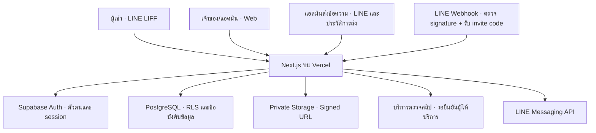
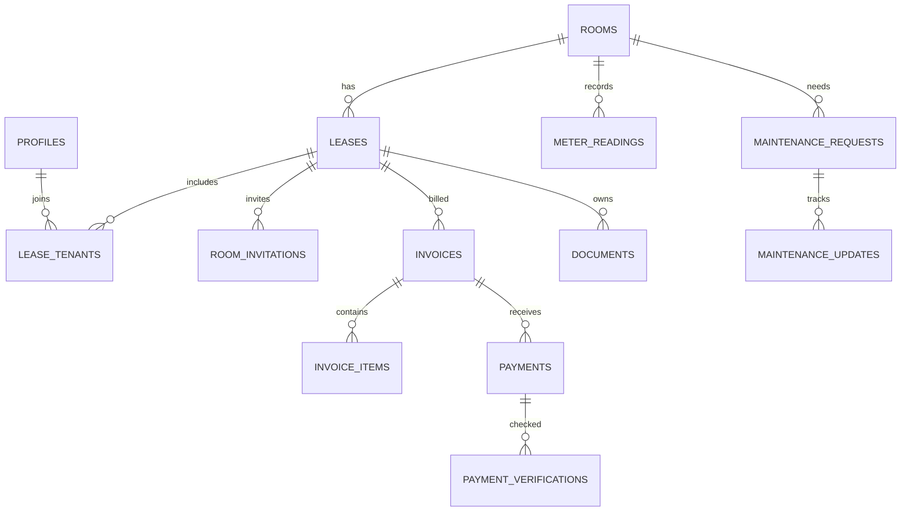

# Blueprint ระบบจัดการหอพักผ่าน LINE

ฉบับจัดทำใหม่ วันที่ 16 ตุลาคม 2569 (2026-10-16)  
โครงการ: Dormitory (Customer) / `dormitory-line`  
สถานะเอกสาร: แบบระบบเพื่อพัฒนาและทบทวน ไม่ใช่หลักฐานว่าฟังก์ชันทั้งหมดทำงานแล้ว

ใช้คู่กับ [Roadmap](ROADMAP.md) สำหรับลำดับงานและเกณฑ์จบเฟส ฐานตรวจโค้ดคือ commit `1a93b88` ก่อนเพิ่มเอกสารชุดนี้ ข้อความ “มีแล้ว” หมายถึงพบใน source code เท่านั้น ส่วน “ต้องพัฒนา” เป็นเป้าหมายของงานถัดไป

## 1. ภาพรวมผลิตภัณฑ์

ระบบดูแลหอพักผ่าน LINE LIFF สำหรับผู้เช่า และเว็บสำหรับเจ้าของ/แอดมิน ขอบเขตบรีฟคือ 18 ห้องพักและ 1 ร้านค้า รวม 19 ยูนิต ใช้สัญญาเช่าเป็นตัวเชื่อมระหว่างยูนิต ผู้เช่า บิล และเอกสาร

| ผู้ใช้ | งานหลัก |
|---|---|
| เจ้าของ (`owner`) | ดูภาพรวม ตั้งค่ารับเงิน จัดการห้อง/สัญญา ตรวจยอด และติดตามการทำงาน |
| แอดมิน (`admin`) | จดมิเตอร์ ออกบิล ตรวจสลิป ดูแลเอกสาร และรับงานซ่อม |
| ผู้เช่า (`tenant`) | รับคำเชิญ ดูข้อมูลตามสัญญา ดูบิล ส่งสลิป ดูเอกสาร และแจ้งซ่อม |

Schema ปัจจุบันมี 3 role แบบคงที่ และ `owner/admin` ใช้ `is_staff()` ร่วมกัน ยังไม่ได้แยกขอบเขตสิทธิ์เจ้าของกับแอดมินละเอียด การเพิ่มช่าง/Staff เป็นงานต่อยอด ไม่ถือว่ามีแล้ว

## 2. สถาปัตยกรรมเป้าหมาย

เทคโนโลยีตาม `package.json`: Next.js 16.4.2, React 19.3.0, Supabase client/SSR และ LIFF SDK เป็นค่าที่ประกาศในโครงการ ไม่ใช่การรับรองเวอร์ชันล่าสุดของผู้ให้บริการ

กติกาแบ่งหน้าที่:

- UI รับข้อมูล แสดงผล และส่งคำขอ ไม่เป็นผู้ตัดสินยอดเงินหรือสิทธิ์
- Server ตรวจตัวตนและสิทธิ์ก่อนคำนวณบิล ตรวจสลิป อนุมัติ หรือออก Signed URL
- ฐานข้อมูลใช้ RLS/constraints ประกอบการป้องกันข้อมูลผิดหรือซ้ำ
- Service Role อยู่ฝั่ง Server เท่านั้น ทุกคำขอที่ใช้สิทธิ์นี้ต้องตรวจสิทธิ์เอง เพราะไม่ควรอาศัย RLS ของผู้ใช้แทน
- งานส่งข้อความแยกผลสำเร็จออกจากงานเงิน หากส่ง LINE ไม่สำเร็จต้องไม่ย้อนผลชำระที่บันทึกสำเร็จไปแล้ว

Supabase Realtime อยู่ในสถาปัตยกรรมบรีฟเดิม แต่ยังไม่พบ implementation ไม่ถือเป็นข้อกำหนดต้องเพิ่มก่อน MVP เว้นแต่จำเป็นต่อประสบการณ์ที่ตกลงกัน

## 3. ขอบเขตหน้าจอ

### ผู้เช่า

| Route ที่มีไฟล์แล้ว | หน้าที่เป้าหมาย | ข้อมูลสำคัญ |
|---|---|---|
| `/liff` | ภาพรวมของผู้เช่า | ห้อง ยอดค้าง วันครบกำหนด ปุ่มลัด และกราฟการใช้ไฟ |
| `/liff/join/[token]` | แจ้งวิธีใหม่สำหรับลิงก์เก่า | แจ้งให้ขอรหัสจากแอดมินและส่งหา LINE Bot; ไม่มีการรับลิงก์เดิม |
| `/liff/bills/[id]` | รายละเอียดบิลและส่งสลิป | รายการคิดเงิน QR ผลตรวจ และเหตุผลที่ต้องแก้ไข |
| `/liff/meters` | ดูประวัติใช้ไฟ | เลขเดิม/ใหม่ หน่วย รูป และกราฟตามสิทธิ์ |
| `/liff/documents` | ดูสัญญาและหลักฐาน | PDF สัญญา สลิป และเอกสารที่มีจริง; ใบเสร็จอัตโนมัติเป็นงานต่อยอด |
| `/liff/maintenance` | แจ้งซ่อมและติดตาม | ฟอร์ม รูป หมวด ความเร่งด่วน สถานะ และยืนยันปิดงาน |

### เจ้าของและแอดมิน

| Route ที่มีไฟล์แล้ว | หน้าที่เป้าหมาย |
|---|---|
| `/admin` | สถานะยูนิต ยอดเรียกเก็บ/รับแล้ว/ค้าง และรายการต้องจัดการ |
| `/admin/rooms` | จัดการห้องพักและร้านค้า |
| `/admin/leases` | สัญญา ผู้เช่าร่วม ลิงก์/QR เชิญ และการย้ายออก |
| `/admin/meters` | บันทึกมิเตอร์เป็นชุด แนบรูป และตรวจค่าผิดปกติ |
| `/admin/billing` | สร้าง ตรวจ ออก และยกเลิกบิลตามกติกา |
| `/admin/payments` | ตรวจผลสลิปและอนุมัติ/ปฏิเสธพร้อมเหตุผล |
| `/admin/maintenance` | คิวงาน รับงาน อัปเดต และติดตามปิดงาน |
| `/admin/settings` | ตั้งค่าหอ บัญชีรับเงิน และการเชื่อม LINE |

ปัจจุบันหน้าส่วนใหญ่เป็น placeholder ไม่มี CRUD/แดชบอร์ดข้อมูลจริง การเพิ่ม route ไม่เท่ากับส่งมอบฟังก์ชันแล้ว ทุกหน้าต้องมี loading, empty, error และ access-denied ที่เหมาะกับงาน

## 4. ตัวตนและขอบเขตการเข้าถึง

เส้นทางเป้าหมาย: เปิด LIFF → LINE Login → ส่ง ID token ให้ Server ตรวจ → จับคู่ตัวตน → สร้าง Supabase session → ใช้ `auth.uid()` ตรวจสิทธิ์ → อ่าน/ทำรายการตามสัญญา

วิธีออก Supabase session ที่ใช้จริง: สะพาน `POST /api/auth/line` ตรวจ ID token กับ LINE (`/oauth2/v2.1/verify`,
aud ต้องตรง `LINE_LOGIN_CHANNEL_ID`) แล้วหา/สร้าง auth user ผ่าน Service Role (email สังเคราะห์
`line_<userId>@line.local`) ผูก `profiles.line_user_id` จากนั้นออก magiclink + `verifyOtp` ฝั่ง server
เพื่อตั้ง session cookie ให้เบราว์เซอร์ ไม่ต้องเปิด LINE provider ใน Supabase (Supabase ไม่มี LINE เป็น
built-in provider) ปัจจุบันสะพานเรียกได้จริง LIFF layout เรียกสะพานนี้แล้ว รอกรอกค่า LIFF ID + Channel ID
และทดสอบด้วย token จริง

| ทรัพยากร | ผู้เช่า | เจ้าของ/แอดมิน | จุดที่ต้องพัฒนา/ตรวจเพิ่ม |
|---|---|---|---|
| Profile | อ่านของตนเอง | policy ระดับแถวให้ staff จัดการได้ | API แก้ profile ต้องไม่เปิดให้ยกระดับ role เอง |
| ห้อง | อ่านห้องของสัญญา active | จัดการข้อมูล | ป้องกันหน้าและ Server operation |
| สัญญา/บิล/รายการบิล/เอกสาร | อ่านตาม `lease_tenants` | จัดการตามสิทธิ์ | นโยบายอ่านย้อนหลังหลังย้ายออกต้องให้ลูกค้ายืนยัน |
| มิเตอร์/งานซ่อม | อ่านตามห้องและช่วงสัญญา | จัดการข้อมูล | ขอบเขตช่วงข้อมูลกลางเดือนต้องตรงรอบใช้งานจริง |
| การชำระ | ส่ง `invoice_id`, `slip_path` เฉพาะบิลตนเองได้ตามสิทธิ์คอลัมน์ | อนุมัติผ่าน Server | ตรวจอายุสัญญาและสถานะบิลก่อนรับคำขอ |
| แจ้งซ่อม | สร้างเฉพาะห้อง active ผ่านคอลัมน์ที่อนุญาต | รับ/อัปเดตผ่าน flow ที่ตรวจสิทธิ์ | ไม่ให้ client กำหนดสถานะสำเร็จเอง |
| Invite/ผลตรวจสลิป/Audit | ไม่เปิดอ่านให้ผู้เช่าโดยตรง | ใช้ตามสิทธิ์งาน | จำกัดข้อมูลดิบและไม่ส่ง secret ไป client |
| ไฟล์ Private | เฉพาะไฟล์ที่มีสิทธิ์ | ตามสิทธิ์งาน | ยังไม่มี Storage object policies หรือ Signed URL flow |

RLS ปัจจุบันให้ผู้เช่าเก่าอ่านบิล/เอกสารในสัญญาที่เคยผูกได้ แต่ไม่เห็นข้อมูลของสัญญาใหม่ในห้องเดิม และไม่เห็นห้อง active หลังสัญญาจบ อย่าสรุปว่า “ปิดสัญญาแล้วอ่านอะไรไม่ได้ทั้งหมด” API การส่งสลิปและขอบเขตข้อมูลย้อนหลังต้องมีกติกาเพิ่มตาม Q-07 ใน Roadmap

## 5. แบบจำลองข้อมูลปัจจุบัน

มี 15 ตารางจาก migration เริ่มต้น:

| กลุ่ม | ตาราง | ความสัมพันธ์/หน้าที่ |
|---|---|---|
| ตัวตน | `profiles` | อ้าง `auth.users`; เก็บ LINE User ID ชื่อ เบอร์ และ role |
| ยูนิต | `rooms` | เลขห้อง ประเภท ชั้น และสถานะ |
| สัญญา | `leases` | อ้างห้อง เก็บวันเช่า ราคา ค่าน้ำ ค่าไฟ due_day เงินประกัน และสถานะ |
| ผู้ร่วมเช่า | `lease_tenants` | เชื่อม profile ↔ lease พร้อม `is_primary` |
| คำเชิญ | `room_invitations` | อ้าง lease; hash, หมดอายุ, ผู้ใช้และเวลาที่ใช้ |
| มิเตอร์ | `meter_readings` | อ้างห้อง; งวด เลขเดิม/ใหม่ หน่วย รูป และผู้บันทึก |
| บิล | `invoices` | อ้าง lease; งวด วันออก/ครบกำหนด ยอดรวม และสถานะ |
| รายการบิล | `invoice_items` | ค่าเช่า น้ำ ไฟ รายการเพิ่ม ส่วนลด/ค่าปรับ พร้อมราคา ณ งวดนั้น |
| รับชำระ | `payments` | อ้างบิล; ยอด สลิป ผลพิจารณา ผู้ตรวจ และเหตุผล |
| ผลตรวจ | `payment_verifications` | อ้าง payment; provider, reference, ผลดิบ และเวลาตรวจ |
| เอกสาร | `documents` | อ้าง lease; ชนิดและตำแหน่งไฟล์ |
| งานซ่อม | `maintenance_requests` | อ้างห้อง; หมวด ความเร่งด่วน รายละเอียด และสถานะ |
| ประวัติซ่อม | `maintenance_updates` | อ้างงาน; สถานะ หมายเหตุ รูป และผู้บันทึก |
| แจ้งเตือน | `notifications` | ผู้รับ ประเภท ช่องทาง และเวลา |
| ตรวจย้อนหลัง | `audit_logs` | ผู้ทำ รายการ ตาราง record และข้อมูลก่อน/หลัง |

ข้อบังคับที่มีแล้ว: เงินเป็น `numeric(12,2)`, บิล unique `(lease_id, period)`, มิเตอร์ unique `(room_id, period)`, reference ตรวจสลิป unique เมื่อมีค่า, สถานะหลาย entity มี CHECK และ RLS เปิดครบตารางที่ประกาศ

สิ่งที่ต้องพัฒนาเพิ่มเติมก่อนถือว่ารองรับงานจริง:

- ป้องกันสัญญา active ซ้อนห้อง/ช่วงเวลาตามกติกาที่ตกลง; ปัจจุบันยังไม่มี constraint นี้
- นิยามงวดมิเตอร์สำหรับช่วงเช่ากลางเดือน เพราะปัจจุบันตรวจสิทธิ์มิเตอร์ด้วย `period` ซึ่งแทนวันที่ 1 ไม่ใช่ช่วงการใช้งานเต็มงวด
- เพิ่ม validation เลขมิเตอร์ ยอด/รายการบิล และ transition ของสถานะให้ครบ; enum/CHECK สถานะไม่ควบคุมลำดับการเปลี่ยนสถานะ
- รองรับหลายรูปแจ้งซ่อมและผู้แจ้ง: ปัจจุบันไม่มีชุดรูปหรือ `created_by` ใน `maintenance_requests` แม้ update จะมีรูปได้หนึ่ง path ต่อแถว
- จัดเก็บค่าหอ บัญชีรับเงิน/PromptPay และนโยบายออกบิลที่หน้าตั้งค่าต้องใช้; ยังไม่มีตารางเฉพาะ
- รองรับการเพิกถอน invite; ปัจจุบันมีเวลาหมดอายุ/ใช้แล้ว แต่ไม่มีสถานะเพิกถอนโดยตรง
- เพิ่มโครงสร้างติดตามงานส่งข้อความ เช่น event key, สถานะรอ/ส่ง/ล้มเหลว, จำนวนครั้ง retry และผลตอบกลับ; `notifications.sent_at` ปัจจุบันยังไม่เพียงพอยืนยันการส่งสำเร็จ
- เขียน audit log จริงและล็อกบิล paid; ปัจจุบันมีตารางแต่ยังไม่มี flow/triggers ที่บังคับงานเหล่านี้

รายการข้างต้นเป็นข้อกำหนดออกแบบเพื่อพัฒนาต่อ ยังไม่ได้แก้ schema ในงานจัดทำเอกสารนี้

## 6. Flow หลักและเงื่อนไขยอมรับ

### 6.1 ผูกผู้เช่ากับสัญญา

เจ้าหน้าที่สร้างห้อง/สัญญา → ออก token สุ่ม → เก็บ hash พร้อมอายุ 7 วันตามบรีฟ → ส่งลิงก์/QR → ผู้เช่า Login และยืนยันชื่อ/เบอร์ → Server ตรวจสัญญาและ token → ผูก `lease_tenants` และทำเครื่องหมายใช้แล้วใน transaction เดียว → แจ้งผล

ต้องปฏิเสธ token ผิด หมดอายุ เพิกถอน ใช้แล้ว หรือสัญญาที่ไม่รับผู้เช่าใหม่ การกดรับพร้อมกันต้องสำเร็จได้เพียงตามสิทธิ์ของคำเชิญนั้น Token ห้ามปรากฏใน log ที่ไม่จำเป็น

### 6.2 มิเตอร์และออกบิล

บันทึกมิเตอร์/รูป → ตรวจความครบของงวด → เลือกสัญญาที่ต้องออกบิล → คำนวณบน Server → สร้างบิล/รายการและ audit แบบ atomic → ออกบิล → เข้าคิว LINE

สูตรพื้นฐานตามบรีฟ:

`ยอดบิล = ค่าเช่า + ค่าน้ำเหมาจ่าย + ((เลขใหม่ − เลขเดิม) × ค่าไฟต่อหน่วย) + รายการเพิ่ม − ส่วนลด`

ค่าปรับคิดเฉพาะเมื่อมีนโยบายที่ลูกค้ายืนยัน ยังไม่กำหนดอัตราเอง เก็บราคาและยอดแต่ละรายการของงวดไว้ ห้ามดึงราคาปัจจุบันมาคำนวณบิลเก่าใหม่

`due_day = 31` มีความหมายตามบรีฟว่าใช้วันสุดท้ายของเดือน ส่วน 10 ใช้วันที่ 10 ไม่ hardcode ชื่อห้อง 205 ในเอนจิน แต่ละสัญญาต้องกำหนดได้ การใช้ due_day ค่าอื่นในเดือนสั้นต้องยืนยันวิธีก่อน implement

ต้องตกลงให้ชัดว่า `period` คือเดือนค่าเช่าหรือเดือนที่ออกบิล และมิเตอร์เป็นช่วงใด บรีฟเตือนจดวันที่ 1 แต่ออกบิลวันที่ 25 จึงยังสรุปวิธีจับคู่ไม่ได้ หากมิเตอร์ไม่ครบต้องแจ้งและรอแก้ ไม่แปลงเป็นศูนย์เงียบ ๆ

### 6.3 ตรวจสลิปและอนุมัติ

ผู้เช่าเปิดบิล → ดูข้อมูลรับเงิน/QR → ส่งสลิป → Server ตรวจสิทธิ์บิลและชนิด/ขนาดไฟล์ → เก็บ Private → เรียกผู้ให้บริการ → เทียบผู้รับ ยอด วันเวลา และ reference → ให้แอดมินตรวจในช่วงเริ่มใช้ → บันทึกอนุมัติและสถานะบิลพร้อม audit → แจ้งผล

บรีฟเดิมเรียก Okslip แต่ source code ใช้ SlipOK (`/api/slipok/verify`, `SLIPOK_*`, `slipok_passed/slipok_failed`) ยังไม่มีหลักฐานว่าเปลี่ยนผู้ให้บริการโดยลูกค้ายืนยัน ต้องปิด Q-01 ก่อนพัฒนา และไม่ถือว่าสองบริการนี้ใช้ API/ผลตอบกลับเหมือนกัน

หากผู้ให้บริการล้มเหลว โควต้าหมด หรือข้อมูลไม่ตรง ให้ `pending_review` พร้อมเหตุผล การตรวจผ่านไม่เท่ากับรับเงินสำเร็จจนผ่านเกณฑ์อนุมัติ การจ่ายบางส่วน/เกินยอด/คืนเงินยังต้องยืนยันขอบเขต ห้ามบังคับ paid จากการอัปโหลดไฟล์อย่างเดียว

### 6.4 งานซ่อม

ผู้เช่าส่งรายละเอียด/รูป → `pending` → เจ้าหน้าที่รับ `accepted` → ดำเนินการ `in_progress` → ถ้ารออะไหล่เป็น `waiting` → เสร็จเป็น `done` → ผู้เช่ายืนยันเป็น `closed`

ทุกการเปลี่ยนสถานะต้องตรวจสิทธิ์ บันทึก timeline และแจ้งผู้เกี่ยวข้อง ลำดับข้างต้นเป็น flow เป้าหมาย; transition ย้อนกลับ/เปิดงานใหม่ยังต้องกำหนดก่อนพัฒนา

### 6.5 ย้ายออกและเอกสาร

ยืนยันวันสิ้นสุด → จบสัญญา → ยกเลิกคำเชิญที่เหลือ/สิทธิ์ทำรายการ active → ปรับสถานะห้อง → รักษาประวัติตามนโยบายที่ยืนยัน การคืนเงินประกันและตรวจสภาพห้องเป็นงานต่อยอดในบรีฟ

MVP เก็บสัญญา PDF ที่ลูกค้ายืนยัน ไม่ถือว่าการ Login LINE หรือการกดผูกห้องเป็นลายมือชื่ออิเล็กทรอนิกส์

## 7. สถานะและกติกาธุรกรรม

| Entity | สถานะตาม schema ปัจจุบัน | กติกาที่ต้องพัฒนา |
|---|---|---|
| ห้อง | `vacant`, `reserved`, `occupied`, `moving_out`, `maintenance` | เปลี่ยนให้สัมพันธ์กับสัญญา ไม่เปิดเช่าซ้ำขณะมีสัญญาขัดกัน |
| สัญญา | `active`, `ended` | ตรวจช่วงเวลา การปิดสัญญา และสิทธิ์หลังย้ายออก |
| บิล | `draft`, `issued`, `verifying`, `pending_review`, `paid`, `overdue`, `void` | ล็อก paid; แสดง overdue จากวันครบกำหนดเฉพาะบิลรอชำระ; กำหนดการแก้/ยกเลิกพร้อม audit |
| การชำระ | `uploaded`, `slipok_passed`, `slipok_failed`, `mismatch`, `approved`, `rejected` | แยกผล provider กับผลรับชำระ; อนุมัติซ้ำไม่เพิ่มยอด; เปลี่ยนชื่อเมื่อยืนยัน provider |
| ซ่อม | `pending`, `accepted`, `in_progress`, `waiting`, `done`, `closed` | ตรวจผู้เปลี่ยนสถานะและบันทึกทุกครั้ง |

งานบิล การรับคำเชิญ และการอนุมัติต้องมี transaction/concurrency protection การมี unique constraint อย่างเดียวไม่รับประกันว่าบิลและรายการย่อยหรือการส่งข้อความจะสมบูรณ์พร้อมกัน

คำเชิญผู้เช่าใช้รหัสสุ่ม 12 ตัว อายุ 7 วัน แสดงให้แอดมินครั้งเดียวและเก็บเฉพาะ hash ผู้เช่าส่งรหัสทางแชทส่วนตัวกับ LINE Bot; Server ต้องตรวจ webhook signature และใช้ `source.userId` จาก LINE event เท่านั้นก่อนเรียก RPC `accept_invite_code` รหัสหมดอายุ/ใช้แล้ว/ถูกยกเลิกต้องไม่ผูกบัญชี ลิงก์เชิญเดิมถูกปิดและหน้าเดิมแจ้งให้ขอรหัสใหม่ LINE Login/LIFF และ Messaging API ต้องอยู่ใต้ Provider เดียวกันเพื่อให้ LINE user ID ตรงกัน

## 8. ไฟล์และความปลอดภัย

มีคำประกาศ Private Bucket `slips`, `meters`, `maintenance`, `documents` ใน migration แล้ว แต่ยังไม่พบ Storage object policies, ระบบ upload หรือการออก Signed URL ที่ตรวจสิทธิ์

เป้าหมายการพัฒนา:

- ตรวจตัวตน ความเป็นเจ้าของ และชนิดงานก่อนอัปโหลด/เปิดไฟล์ ไม่เชื่อ file path จาก client โดยตรง
- แยกตำแหน่งไฟล์ตามทรัพยากรที่อ้าง ตรวจชนิด ขนาด และไฟล์เสียบน Server
- Signed URL อายุสั้น ตรวจสิทธิ์ทุกครั้งก่อนออก และกำหนดอายุจริงก่อน implement
- ห้ามเปิด bucket สาธารณะเพื่อแก้ปัญหาเข้าไฟล์ไม่ได้
- ไม่บันทึก secret, token, รูปสลิป หรือข้อมูลผู้เช่าเต็มชุดลง log โดยไม่จำเป็น
- ตรวจ LINE webhook signature จาก raw body; ข้อความส่วนตัวที่มี invite code ใช้ LINE user ID จาก event และ RPC แบบ idempotent สำหรับ retry ของรหัสเดิม
- ป้องกัน endpoint จากคำขอไม่ผ่านสิทธิ์และการเรียกถี่ รวมการจัดการ session/CSRF ให้สอดคล้องกับวิธี auth ที่เลือก

## 9. API ที่มีและส่วนที่ยังขาด

| API ปัจจุบัน | สิ่งที่มี | สิ่งที่ต้องพัฒนา |
|---|---|---|
| `POST /api/auth/line` | ใช้งานได้ (ตรวจ ID token ผูกตัวตน ตั้ง session) | ต้องการ LIFF ID + Channel ID จริง และทดสอบด้วย token จริง |
| `POST /api/slipok/verify` | stub 501 | auth, upload, provider adapter, ตรวจเงิน และผลอนุมัติ |
| `POST /api/line/webhook` | ตรวจ signature, รับ invite code ทางข้อความส่วนตัว และผูกบัญชีผ่าน RPC | ทดสอบ redelivery และ UAT จริงกับ LINE OA |
| `/admin/messages` Server Actions | ตรวจ owner/admin ก่อนส่ง LINE และบันทึกประวัติ | ตรวจใช้งานกับ LINE OA จริง |

ยังไม่มี Server operations สำหรับ CRUD ห้อง/สัญญา รับคำเชิญ จดมิเตอร์ ออกบิล อนุมัติ เอกสาร และงานซ่อม ต้องกำหนด contract ตอนพัฒนา ไม่ถือว่า route หน้าจอเป็น API ที่ทำงานแล้ว

## 10. การส่งข้อความด้วยแอดมิน

ผู้ใช้เลือก A เมื่อ 17/10/2569: ยกเลิก cron ทั้งหมดและให้แอดมินส่งข้อความจาก `/admin/messages` แทน

- เลือกทุกห้องที่มีสัญญาใช้งาน รายห้อง หรือห้องที่มีบิลรอชำระ
- พิมพ์เองหรือเลือกแม่แบบเตือนชำระ/จดมิเตอร์/ประกาศ พร้อมตัวแปรห้อง ยอด และวันครบกำหนด
- เก็บข้อความ ผู้ส่ง ผู้รับ สถานะ และข้อผิดพลาดใน `notifications` ส่งซ้ำเฉพาะ failed/skipped ด้วยมือ
- ไม่มี token หรือ LINE user ID จะบันทึก skipped; pending ที่ค้างต้องตรวจผลก่อนส่งใหม่
- แสดงสถานะบิลเกินกำหนดจากวันครบกำหนด ไม่มีการออกบิลหรือเตือนตามเวลาอัตโนมัติ

## 11. การตรวจรับและการดูแลระบบ

| ระดับ | หลักฐานที่ต้องได้ |
|---|---|
| ในเครื่อง | typecheck/lint ผ่าน; unit/integration ครอบคลุมเงิน วันที่ token และ concurrency |
| ฐานข้อมูลทดสอบจริง | migration/RLS/GRANT/Storage ตรงพฤติกรรมจริง รวมผู้เช่าเก่าและใหม่ในห้องเดียวกัน |
| เชื่อมบริการจริง | LINE session, webhook, ส่งข้อความ, Signed URL และผลตรวจสลิปจาก provider ที่เลือก |
| อุปกรณ์จริง | เปิด LIFF ใน LINE อัปโหลดรูป/สลิป ดู PDF และ session กลับเข้าแอป |
| UAT ลูกค้า | ใช้ตัวอย่างยอดที่ยืนยัน ทำวงจรสัญญา → บิล → ชำระ → ซ่อม และบันทึกผล |
| ก่อนเปิดใช้ | backup/restore, คู่มือ, เจ้าของบัญชีบริการ, ผู้ดูแล และการอนุมัติปล่อยระบบ |

เมื่อจะเขียน automated mobile tests ต้องสำรวจเส้นทางจริงด้วย ARTEMIS ตาม AGENTS.md ก่อน ใช้ locator ที่ตรวจพบและ wait conditions ชัดเจน งานเอกสารนี้ไม่ได้ทำ mobile exploration หรืออ้างว่าผ่าน mobile test

ผลตรวจในงานนี้: `npm test`, `npm run typecheck`, `npm run lint` ผ่าน โดย `npm test` จำลอง Auth/Storage ส่วนที่จำเป็นใน PGlite ไม่ได้ยืนยัน session, Cloud Storage, provider หรือ production deployment ไม่ได้รัน production build

การสำรองข้อมูลต้องครอบคลุมฐานข้อมูลและไฟล์ที่จำเป็น พร้อมซ้อมกู้คืนจริงก่อนเปิดใช้ กำหนดระยะเก็บกับลูกค้าหลังตรวจเอกสาร ไม่คัดลอกตัวเลขหรือข้อกฎหมายจากร่างมาเป็นนโยบายระบบอัตโนมัติ

## 12. คำถามค้างและเอกสารต้นทาง

ติดตาม Q-01 ถึง Q-08 ใน [Roadmap](ROADMAP.md) โดยเฉพาะ provider ตรวจสลิป รอบบิลร้านค้า ช่วงมิเตอร์ อัตราเงินจริง และเอกสารใช้จริง ก่อนปิดคำถามเหล่านี้ เอกสารนี้ไม่เปลี่ยนขอบเขตเป็นหลายอาคาร/SaaS หรือเพิ่มการลงนามอิเล็กทรอนิกส์ให้โครงการ

แหล่งอ้างอิง:

- บรีฟเดิม 6 หน้า (ขอบเขต ยูนิต โมดูล flow สถานะ และแผนเดิม): ถูกนำออกจาก repo เมื่อ 17/10/2569 (เนื้อหาย้ายเข้า Blueprint/Roadmap แล้ว) ไฟล์ต้นฉบับดูได้จากประวัติ git: `git show 378e902:docs/brief.pdf`
- [migration](../supabase/migrations/20261016000000_init.sql), [RLS test](../supabase/tests/rls.test.mjs): ตารางและสิทธิ์ปัจจุบัน
- [package.json](../package.json), [README](../README.md), [ตัวแปรตัวอย่าง](../.env.example)
- [Admin layout](../app/admin/layout.tsx), [LIFF layout](../app/liff/layout.tsx), [LINE auth](../app/api/auth/line/route.ts), [ตรวจ ID token](../lib/line-auth.ts), [ตรวจสลิป](../app/api/slipok/verify/route.ts), [Webhook](../app/api/line/webhook/route.ts), [ส่งข้อความ](../app/admin/messages/page.tsx)
- ร่าง `../../กฎหมายและช้อตกลง.txt`, `../../สัญญาเช่าห้องพัก.txt`, `../../สัญญาเช่าหอพัก.txt`: ใช้ระบุรายการรอตรวจเท่านั้น ไม่ได้ตรวจรับรองข้อกฎหมายในงานนี้
